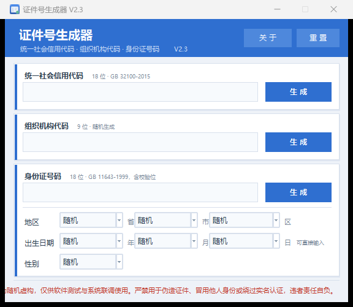
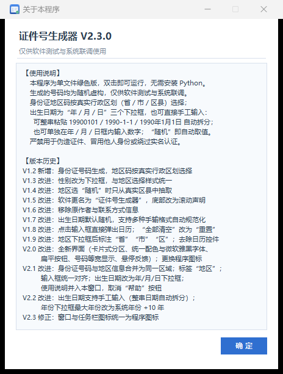

# 证件号生成器 V2.3

[](https://github.com/w5456448820/id-number-generator/actions/workflows/build.yml)
[](LICENSE)

> **本工具生成的号码均为随机虚构，仅供软件开发测试、系统联调、数据脱敏演示等合法场景使用。严禁用于伪造证件、冒用他人身份、绕过实名认证或任何其他违法违规用途，使用者须自行承担全部法律责任。**

基于 tkinter 的 Windows 单文件绿色版工具，可生成三类合法校验的号码：**统一社会信用代码（18 位）**、**组织机构代码（9 位）**、**居民身份证号码（18 位）**，地区码取自真实行政区划。

## 界面预览

| 主界面 | 关于窗口 |
| --- | --- |
|  |  |

## 下载即用

`证件号生成器V2.3.exe` 为 PyInstaller 打包的单文件程序，双击运行，无需安装 Python。

- 文件大小约 10 MB，Windows 10 / 11（x64）
- 无数字签名，首次运行可能触发 SmartScreen 提示，选择"更多信息 → 仍要运行"即可
- 任务栏、窗口标题栏、exe 文件图标统一为 `app.ico`

## 功能特性

| 项目 | 说明 |
| --- | --- |
| 统一社会信用代码 | 18 位，校验位遵循 **GB 32100-2015**（加权因子 + 字符集 `0123456789ABCDEFGHJKLMNPQRTUWXY`） |
| 组织机构代码 | 9 位随机生成 |
| 居民身份证号 | 18 位，校验位遵循 **GB 11643-1999**（加权 `[7,9,10,5,8,4,2,1,6,3,7,9,10,5,8,4,2]`，校验串 `10X98765432`），第 17 位奇男偶女 |
| 地区三级联动 | 内置 `pca-code.json`，31 省 / 342 市 / **2978 个真实区县码**；选择"随机"时只从真实区县中抽取 |
| 出生日期 | 年 / 月 / 日三个下拉框，也可直接手输：整串 `19900101`、`1990-1-1`、`1990年1月1日` 会自动拆分；默认随机 |
| 年份上限 | 系统当前年份 + 10（当前为 2036） |
| 其他 | 性别下拉框、一键重置、号码一键复制、底部滚动合规声明 |

## 从源码运行

```bash
pip install pyinstaller
python id_generator.py
```

需要与脚本同目录的 `pca-code.json`（行政区划）与 `app.ico`（程序图标）。

## 自行打包

```bash
pyinstaller --onefile --noconsole ^
  --icon app.ico ^
  --add-data "pca-code.json;." ^
  --add-data "app.ico;." ^
  --name "证件号生成器V2.3" ^
  id_generator.py
```

> 注意：`--add-data` 必须携带 `pca-code.json`，否则地区数据缺失将生成非法区县码；如需 `--specpath`，数据文件请改用绝对路径。

## 项目结构

```
├── id_generator.py          # 主程序（V2.3 源码）
├── pca-code.json            # 行政区划数据（省 / 市 / 区县，GB/T 2260）
├── app.ico                  # 程序图标（16/32/48/64/128/256 多尺寸）
├── screenshots/             # 界面截图
├── .github/workflows/       # GitHub Actions 自动打包
├── LICENSE                  # MIT 许可证
└── 证件号生成器V2.3.exe      # 打包产物
```

## 版本历史

| 版本 | 变更 |
| --- | --- |
| V1.2 | 新增身份证号码生成，地区码按真实行政区划选择 |
| V1.3 | 性别改为下拉框，与地区选择样式统一 |
| V1.4 | 地区选"随机"时只从真实区县中抽取 |
| V1.5 | 软件更名为"证件号生成器"，底部改为滚动声明 |
| V1.6 | 移除原作者与联系方式信息 |
| V1.7 | 出生日期默认随机，支持多种手输格式自动规范化 |
| V1.8 | 点击输入框直接弹出日历；"全部清空"改为"重置" |
| V1.9 | 地区下拉框后标注"省""市""区"；去除日历控件 |
| V2.0 | 全新卡片式界面、扁平按钮、微软雅黑字体；更换程序图标 |
| V2.1 | 身份证号码与地区合并为同一区域；输入框对齐；出生日期改下拉；使用说明并入关于窗口 |
| V2.2 | 出生日期支持手工输入（整串日期自动拆分）；年份下拉上限改为系统年份 +10 |
| V2.3 | 修复图标未打包导致任务栏显示 Tk 默认图标的问题；`resource_path` 三级查找；设置进程 AppUserModelID，任务栏/标题栏/文件图标统一 |

## 自动打包（GitHub Actions）

工作流文件：`.github/workflows/build.yml`，在 GitHub 云端 Windows runner 上自动完成 PyInstaller 打包。

| 触发方式 | 行为 |
| --- | --- |
| push 到 `main` | 打包 exe，跑启动冒烟测试，产物上传为 Artifact（保留 30 天） |
| push 标签 `v*`（如 `v2.4.0`） | 同上，并自动创建/更新同名 Release，附加 `IDNumberGenerator-<tag>.exe` |
| Pull Request | 仅验证能否打包成功，不发布 |
| 手动 `workflow_dispatch` | 可随时在 Actions 页面点 Run workflow 重跑 |

产物命名规则：`IDNumberGenerator-<tag名>`；非标签触发时为 `IDNumberGenerator-run<构建序号>`。

发布新版本只需：

```bash
git tag v2.4.0
git push origin v2.4.0
```

## 许可证

本项目基于 [MIT License](LICENSE) 开源，可自由使用、修改、分发，须保留版权声明。
鉴于工具性质特殊，LICENSE 中另有附加说明：生成结果仅限测试、联调与脱敏演示，严禁用于伪造证件、冒用身份或绕过实名认证等违法用途。

## 免责声明

本项目仅用于软件测试与教学演示。任何将生成结果用于伪造证件、冒用他人身份、绕过实名认证等行为，均与本项目作者无关，由使用者自行承担全部法律责任。
